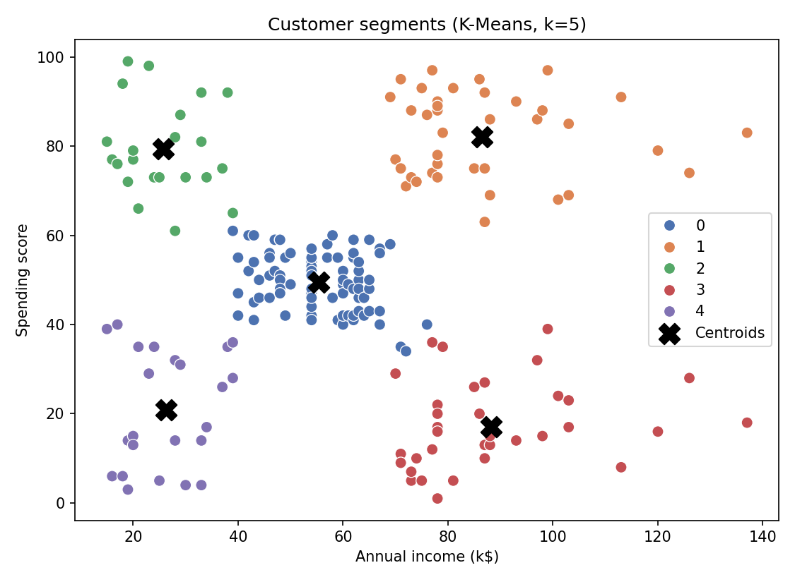
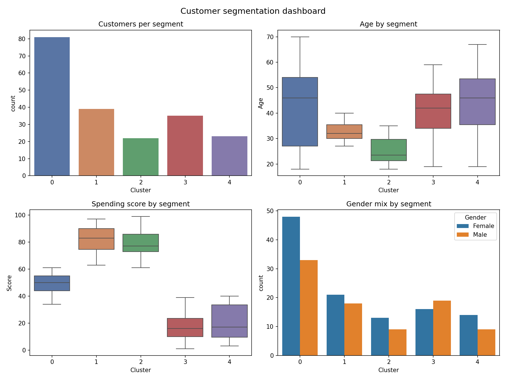

# Customer Segmentation Analysis

Groups mall customers into distinct segments with **K-Means clustering** so marketing can target each group differently.

## Problem
Not all customers spend the same way. Segmenting by income and spending behavior shows who to target with premium offers, who to win over, and who to leave alone.

## Dataset
Mall Customers, a public dataset widely used for clustering practice (200 customers, no missing values): CustomerID, Gender, Age, Annual Income (k$), Spending Score (1-100). A copy is in `data/Mall_Customers.csv`.

## Approach
1. Explore distributions of age, income and spending score.
2. Standardize Annual Income and Spending Score.
3. Choose k with the elbow method and silhouette score (k = 2 to 10).
4. Fit K-Means with k = 5, profile each cluster, and visualize.

## Results
Silhouette score at k=5 is **0.555**, the highest across the k values tested (k=6 is close at 0.540).

| Segment | Customers | Avg age | Avg income (k$) | Avg score |
|---|---|---|---|---|
| Average (middle) | 81 | 42.7 | 55.3 | 49.5 |
| High income, high spend (target) | 39 | 32.7 | 86.5 | 82.1 |
| Low income, high spend | 22 | 25.3 | 25.7 | 79.4 |
| High income, low spend | 35 | 41.1 | 88.2 | 17.1 |
| Low income, low spend | 23 | 45.2 | 26.3 | 20.9 |

Takeaways: the 39 high-income, high-spend customers are the best target for loyalty and premium offers. The 35 high-income, low-spend customers are the biggest opportunity to convert with better-targeted promotions.




Other outputs in `results/`: `choose_k.png`, `distributions.png`, `cluster_profiles.csv`, `customers_with_segments.csv`.

## Dashboard note
The dashboard is built with matplotlib and seaborn (`results/dashboard.png`) rather than Tableau, so it is reproducible from code.

## How to run
```bash
git clone <this-repo-url>
cd customer-segmentation
pip install -r requirements.txt
python segment.py
```

## Tech
Python, scikit-learn, pandas, matplotlib, seaborn.
